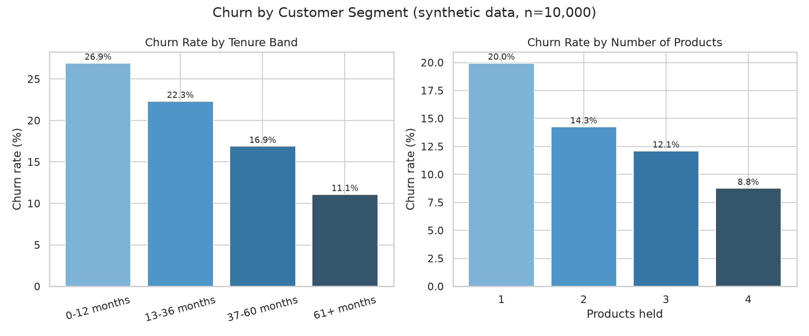
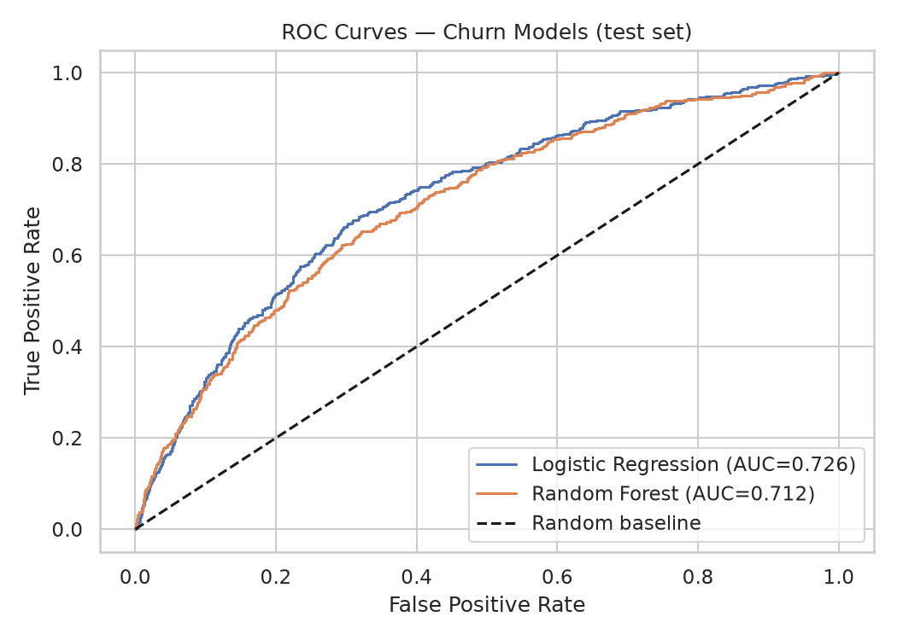
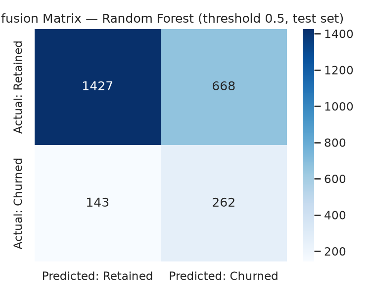
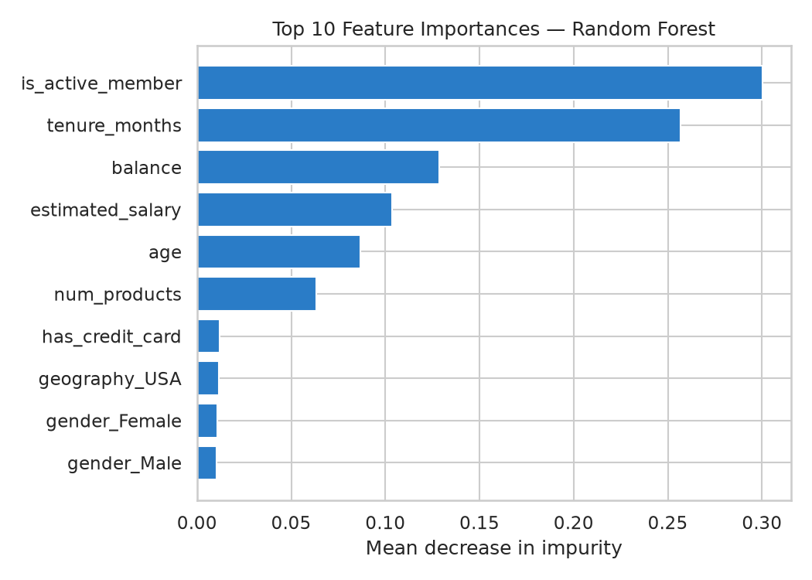

# Banking Customer Churn Prediction

> **Portfolio project · synthetic data.** All 10,000 customer records are generated
> with `numpy` (seed 42) for learning and demonstration purposes. No real customer,
> employer, or proprietary data is used or implied.

## Business Problem

Banks lose a meaningful share of customers every year, and acquiring a replacement
costs far more than retaining an existing one. The business question:

> **Which customers are most likely to churn, and what drives that risk, so
> retention efforts (onboarding outreach, cross-sell, re-engagement) can be
> targeted instead of sprayed?**

This project builds an end-to-end churn analytics workflow: segment analysis in
SQL, exploratory analysis in Python, and two classification models that score
each customer's churn probability.

## Dataset

**`data/customers.csv` — 10,000 synthetic customers (~0.5 MB), overall churn rate 16.21%.**

| Column | Type | Description |
|---|---|---|
| `customer_id` | int | Unique synthetic customer ID |
| `age` | int | Customer age (18–79) |
| `tenure_months` | int | Months as a customer (0–120) |
| `balance` | float | Account balance (USD) |
| `num_products` | int | Bank products held (1–4) |
| `has_credit_card` | int | 1 = holds a credit card |
| `is_active_member` | int | 1 = active member |
| `estimated_salary` | float | Estimated annual salary (USD) |
| `geography` | string | USA / UK / Canada |
| `gender` | string | Male / Female |
| `churned` | int | **Target:** 1 = churned, 0 = retained |

Churn is engineered so that **low activity, short tenure, and fewer products**
raise churn probability — mirroring real-world churn dynamics. Full schema notes
in [`data/README.md`](data/README.md); regenerate with `python src/generate_data.py`.

## Objectives

1. Quantify churn rate by customer segment (tenure, products, geography, balance).
2. Identify the strongest behavioral drivers of churn.
3. Build and compare churn classifiers: interpretable baseline vs. non-linear model.
4. Define dashboard KPIs a retention team could monitor.

## Data Cleaning

Implemented in [`src/data_cleaning.py`](src/data_cleaning.py) (`clean_customers`):

- Schema validation against the expected column list (raises on missing columns).
- Deduplicate on `customer_id`; drop rows missing the target.
- Coerce numeric types; median-impute residual gaps in age/tenure/balance/salary.
- Range guards: age 18–100, tenure 0–120 months, balance ≥ 0, products 1–4.
- Derive `tenure_band` (0–12 / 13–36 / 37–60 / 61+ months) for segment analysis.
- Quality report: 10,000 rows, 16.21% churn, 0 missing values, 0 duplicate IDs.

## SQL Analysis

[`sql/analysis_queries.sql`](sql/analysis_queries.sql) — SQLite-compatible segment
queries (verified against the dataset):

| Query | Finding |
|---|---|
| Churn rate by tenure band | **26.93%** (0–12 mo) → 22.32% (13–36) → 16.89% (37–60) → **11.09%** (61+ mo) |
| Churn rate by products held | **19.96%** (1 product) → 14.26% (2) → 12.10% (3) → **8.76%** (4) |
| Churn rate by geography | USA 16.83%, UK 15.79%, Canada 15.35% — geography is a weak driver |
| Avg balance: churned vs retained | Churned: $47,398 avg balance, 46.6 mo tenure, **30.35%** active · Retained: $50,730, 62.1 mo, **59.51%** active |

The executed notebook ([`notebooks/analysis.ipynb`](notebooks/analysis.ipynb)) runs
all four queries in SQLite and displays the results.

## EDA

Helpers in [`src/analysis.py`](src/analysis.py); charts inline in the executed notebook:

- **Churn concentrates in new, single-product, inactive customers.** The 0–12 month
  band churns at 2.4× the rate of 61+ month customers; 1-product holders churn at
  2.3× the rate of 4-product holders.
- **Activity gap is stark:** churned customers average 1.61 products and 46.6 months
  tenure vs. 1.84 products and 62.1 months for retained customers.
- **High-value segment is at risk too:** the at-risk segment (inactive, ≤24 mo
  tenure, 1 product) is only 4.3% of the base (430 customers) but churns at 46.7% —
  the highest-leverage retention target.

## Key Insights

1. **Inactivity is the strongest churn signal.** Churned customers are active only
   ~30% of the time vs. ~60% for retained customers, and `is_active_member` is the
   top model feature (importance 0.300).
2. **New customers churn ~2.4× more than long-tenured ones** (26.93% vs. 11.09%) —
   the first year is the highest-leverage retention window.
3. **Single-product customers churn 2.3× more than 4-product ones** (19.96% vs.
   8.76%) — cross-sell is a retention lever, not just a revenue lever.

## ML Methodology

[`src/model.py`](src/model.py) — reproducible end-to-end script.

- **Split:** 75/25 train/test, stratified on the target (train 7,500 @ 16.21%,
  test 2,500 @ 16.20%), `random_state=42`.
- **Preprocessing pipeline:** `StandardScaler` on 7 numeric features +
  `OneHotEncoder` on geography/gender.
- **Algorithms:**
  - *Logistic Regression* — interpretable baseline, `class_weight="balanced"`,
    `max_iter=1000`.
  - *Random Forest* — 200 trees, `max_depth=12`, `min_samples_leaf=20`,
    `class_weight="balanced"`.
- **Validation:** 5-fold stratified cross-validation ROC-AUC on the training set,
  plus a held-out test set.

### Test-set metrics (threshold 0.5)

| Model | Accuracy | Precision | Recall | F1 | ROC-AUC |
|---|---|---|---|---|---|
| Logistic Regression | 0.668 | 0.285 | 0.696 | 0.405 | **0.726** |
| Random Forest | 0.676 | 0.282 | 0.647 | 0.393 | **0.712** |

5-fold CV ROC-AUC: Logistic Regression 0.720 ± 0.013 · Random Forest 0.717 ± 0.014.

**Threshold analysis** (Random Forest — precision/recall trade-off):

| Threshold | Precision | Recall | F1 |
|---|---|---|---|
| 0.3 | 0.201 | **0.899** | 0.329 |
| 0.4 | 0.237 | 0.788 | 0.365 |
| 0.5 | 0.282 | 0.647 | 0.393 |
| 0.6 | 0.345 | 0.417 | 0.378 |

For a cheap retention intervention (e.g., a targeted email), a recall-first
threshold of ~0.3–0.4 is preferred: it catches ~80–90% of churners at the cost of
precision.

**Top drivers** (Random Forest importance): `is_active_member` 0.300 >
`tenure_months` 0.257 > `balance` 0.129 > `estimated_salary` 0.104 > `age` 0.087 >
`num_products` 0.063. Logistic regression agrees on direction: inactivity,
short tenure, and fewer products all increase churn odds.

## Dashboard

KPI definitions live in [`dashboard/README.md`](dashboard/README.md). Charts
(rendered at 150 dpi):









## Results & Metrics

- **Segment model:** churn concentrated in 0–12 month, single-product, inactive
  customers (up to 26.93% churn vs. 11.09% baseline for long-tenured customers).
- **Classification:** test ROC-AUC **0.726** (Logistic Regression) / **0.712**
  (Random Forest); both well above random, with stable 5-fold CV.
- **Actionable segment:** 430 at-risk customers (4.3% of base) churning at 46.7% —
  sized for a pilot retention campaign.
- **Decision guidance:** threshold analysis quantifies the precision/recall
  trade-off for campaign targeting.

## Technologies Used

Python · pandas · NumPy · scikit-learn (LogisticRegression, RandomForest,
pipelines, stratified CV) · matplotlib · seaborn · SQLite (SQL segment analysis) ·
Jupyter.

## How to Run

```bash
# 1. Install dependencies
pip install -r requirements.txt

# 2. Regenerate the synthetic dataset (seeded, reproducible)
python src/generate_data.py

# 3. Run the full modeling pipeline (prints metrics, saves charts to images/)
python src/model.py

# 4. Open the executed notebook
jupyter notebook notebooks/analysis.ipynb

# 5. Run the SQL segment analysis (e.g., with sqlite3)
sqlite3 :memory: < sql/analysis_queries.sql   # after importing data/customers.csv as customers
```

## Resume-Ready Description

> Built a churn prediction pipeline on synthetic banking data (10k customers):
> feature engineering and SQL segment analysis identifying inactivity, short
> tenure, and single-product holdings as top churn drivers; compared logistic
> regression vs. random forest (test ROC-AUC 0.726) with threshold analysis for
> retention-campaign targeting.

## Author

**Sreya Peddu** — Senior Data Analyst (SQL · Python · Snowflake · Tableau ·
Power BI · dbt · scikit-learn)
GitHub: [github.com/sreyapeddu-analytics](https://github.com/sreyapeddu-analytics)
